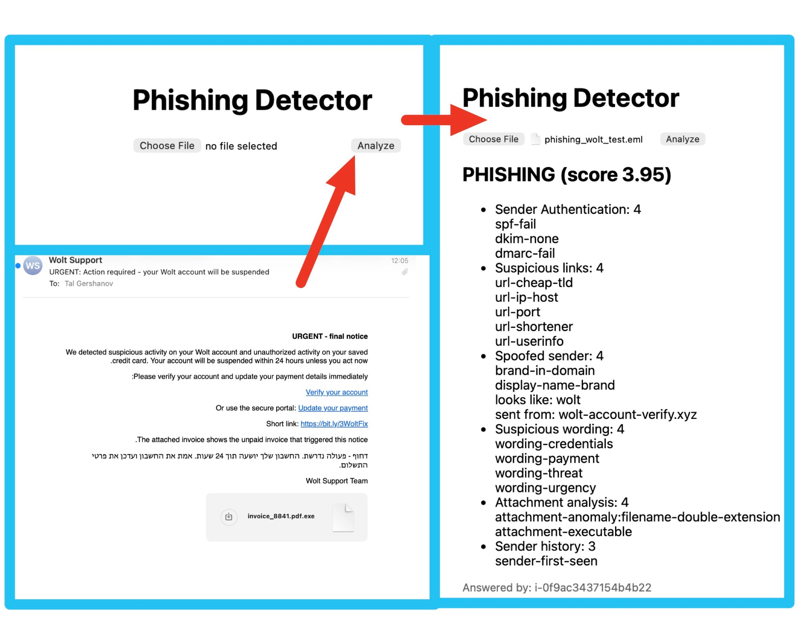
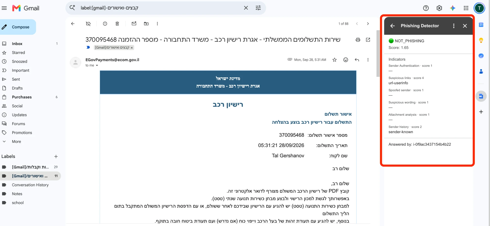
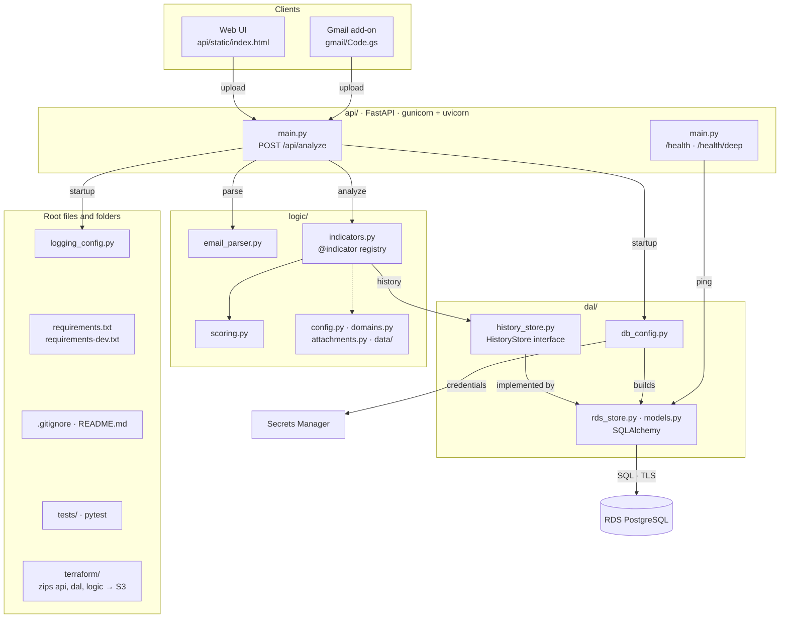
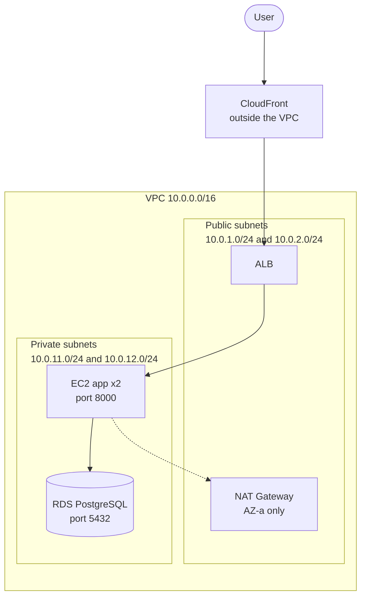
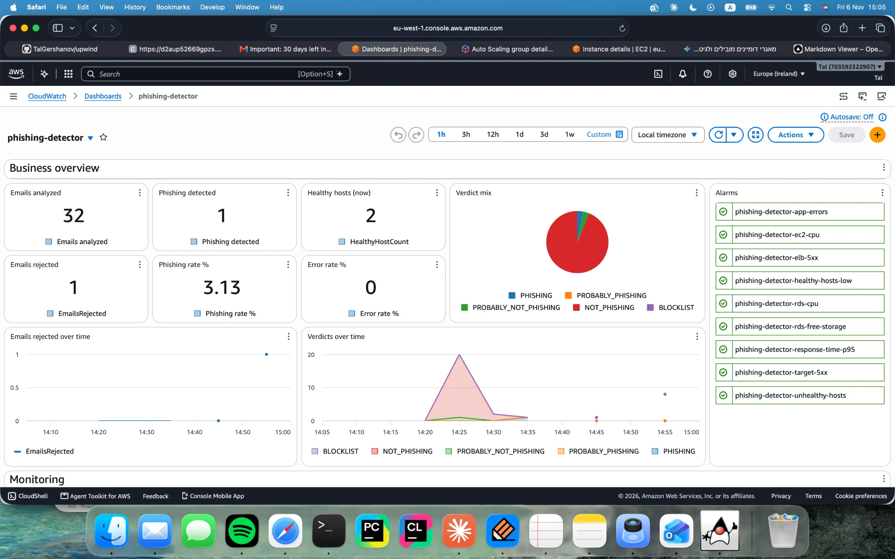
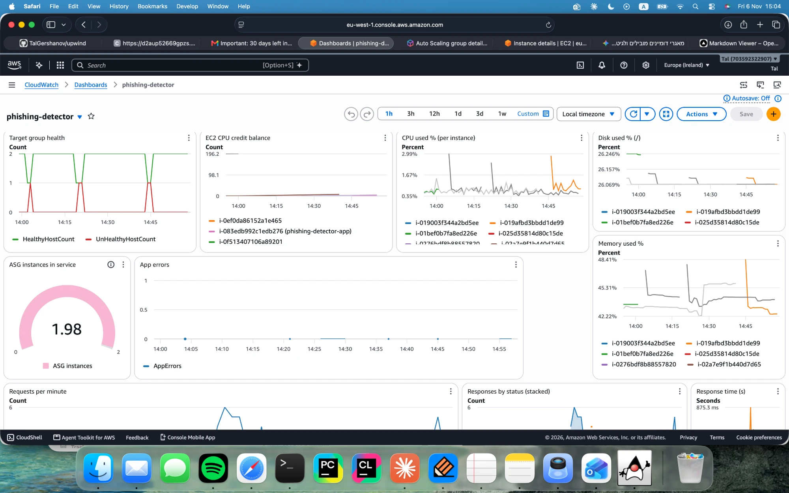
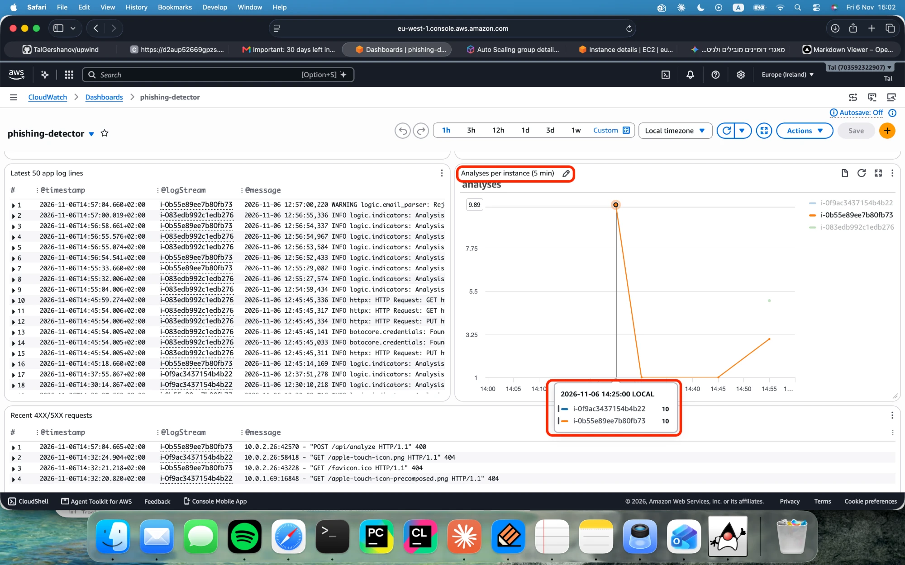
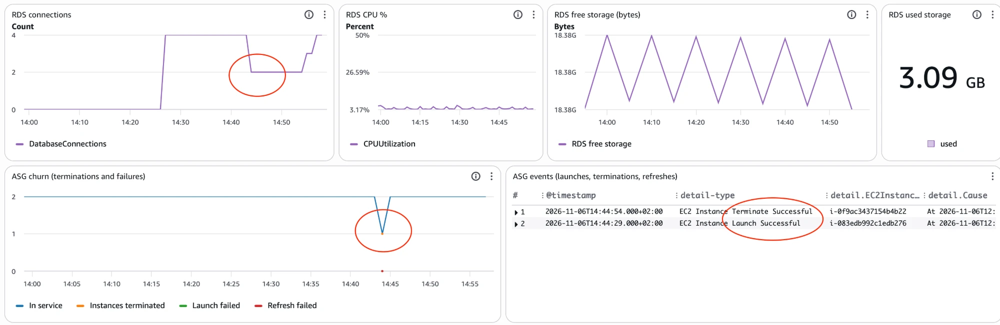
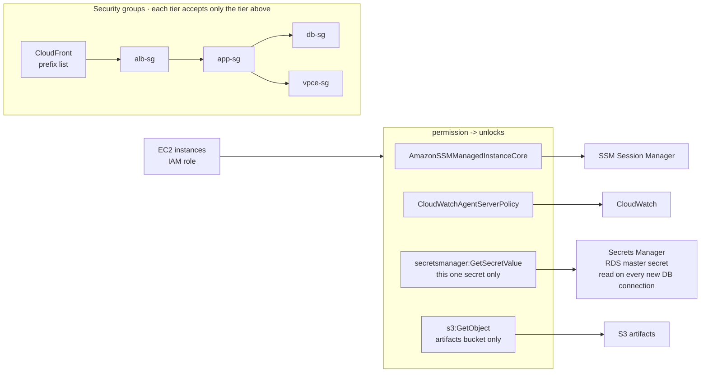
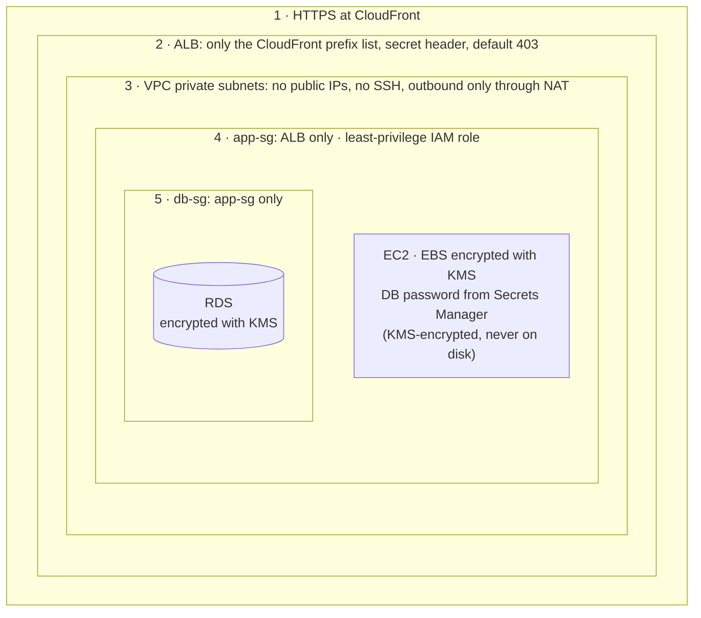

# Phishing Detector

Scans an email for phishing indicators and returns a verdict with reasons.
Runs on AWS: CloudFront → ALB → 2× EC2 (Auto Scaling Group) → RDS PostgreSQL. Built with Terraform.

**Web UI**



**Gmail add-on**



---

## Code layers



---

## Indicators

Each indicator scores 1–4. The verdict is the weighted average:
`< 1.75` NOT_PHISHING · `< 2.5` PROBABLY_NOT_PHISHING · `< 3.25` PROBABLY_PHISHING · else PHISHING.
A sender already on the blocklist returns BLOCKLIST with its saved report.

| Indicator | Weight | Logic |
|---|---|---|
| Sender Authentication | 0.20 | SPF / DKIM / DMARC from the top `Authentication-Results` header, only if a trusted server added it |
| Suspicious links | 0.20 | Per URL: IP host, `user@`, shortener, cheap TLD, many subdomains, punycode, odd port. |
| Spoofed sender | 0.25 | Known brand in the sender domain or display name, same name on another TLD, or a look-alike (edit distance ≤ 2) |
| Suspicious wording | 0.10 | Urgency, credentials, payment, threat and prize phrases (English and Hebrew); more categories = higher score |
| Attachment analysis | 0.20 | Executables, double extensions, macro documents, MIME mismatch, risky zips (metadata only, never extracted) |
| Sender history | 0.05 | Sender reputation in RDS: first seen, mostly phishing, or allowlisted after 3 clean authenticated messages |

### Add an indicator

Only new code is needed, in `logic/indicators.py`:

1. Write a function `(context: EmailContext) -> IndicatorResult`.
2. Decorate it with `@indicator('Name', weight=...)`. Weights are relative.
3. Return `IndicatorResult(score, reasons, details)` with a score from `config` (1–4).

The registry, scoring, report, UI and Gmail card pick it up. Word and domain lists go in `logic/config.py`.

---

## AWS infrastructure




---

## Monitoring
# built a dashboard - widgets for a business-y perspective:



# and monitoring - look below


---

## Availability

- **2 Availability Zones**
- **Stateless app**:  
- **Application Load Balancer**



*Both instances handle requests, and each writes to its own log stream.*

- **Auto Scaling Group** (min = max = 2): a failed instance is replaced automatically, code updates roll through with at least 50% healthy.




*An instance was terminated by hand: in service dropped from 2 to 1, the ASG launched a replacement, and the events table shows Terminate and Launch.*


---

## Permissions




---

## Reliability

| Failure | How it is handled | Where to see it |
|---|---|---|
| Bad upload (empty, over 5 MB, not an email) | 400 / 413, logged as a warning, the API keeps running | `EmailsRejected` metric, *Emails rejected* widgets |
| Exception in the app | Logged as `ERROR` | `AppErrors` metric, alarm over 5 in 5 min |
| 5XX from the app or the ALB | Counted by the ALB | Alarms `target-5xx`, `elb-5xx`; *Responses by status*, *Error rate %*, *Recent 4XX/5XX requests* |
| Slow responses | Latency percentiles | Alarm `response-time-p95` over 1 s; *Response time* widget |
| Database unreachable | Short timeouts (connect 5 s, pool 10 s), pre-ping, `/health/deep` returns 503 | `AppErrors`, alarms `rds-cpu`, `rds-free-storage` |
| Two instances boot together | `create_schema` takes a DB lock and retries 5 times | `/phishing-detector/boot` log group |

| Monitoring itself fails | CloudWatch agent is installed last and its failure never blocks the app | Boot log |

Every alarm notifies the SNS email topic. Logs are kept 14 days and rotated on disk.

---

## Security

Layers, outermost to innermost:



Also: S3 buckets encrypted (SSE-S3) with all public access blocked · CloudTrail audit of every API call · attachments are analysed statically and never executed · uploads capped at 5 MB.

CloudFront talks to the ALB over HTTP (no custom domain, so no certificate); the ALB only accepts it from CloudFront.


---

## Deploy 

```bash
# RDS "phishing-detector-db" is created by hand first. Confirm the SNS email afterwards.
terraform apply -var alert_email=you@example.com
```
## for the gmail add-on: 
#### update the new url in script.google.com -> nav to project -> project settings -> Script Properties


